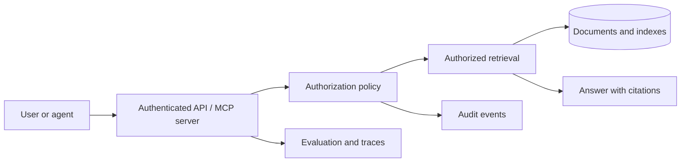

# EKE Ops

**Enterprise Knowledge EvalOps** is a planned platform for building, securing, and evaluating AI assistants over enterprise documents. The goal is to compare retrieval and agent approaches while enforcing access rules wherever knowledge is read or exposed.

> **Project status:** Early scaffold. This repository contains the planned folder structure and a placeholder `eke-ops` command. The platform features below are a development roadmap, not working functionality.

## What the project aims to do

- [ ] Ingest and version enterprise documents with tenant, owner, and classification metadata.
- [ ] Answer questions using authorized evidence from dense, hybrid, and eventually graph retrieval.
- [ ] Expose knowledge tools through MCP and orchestrate them with an agent that cites its sources.
- [ ] Run repeatable evaluations of retrieval quality, answer quality, latency, and cost.
- [ ] Record traces and audit events without exposing restricted content to unauthorized users.

## Current repository

```text
.
├── architecture.md       # Architecture and system flows
├── docs/adr/             # Architecture decision records
├── frontend/             # Future Next.js dashboard
├── src/eke_ops/
│   ├── api/              # HTTP API boundary
│   ├── core/             # Shared settings and cross-cutting types
│   ├── modules/          # Feature modules (see below)
│   ├── infrastructure/   # Database, queue, auth, telemetry adapters
│   ├── mcp/              # Separate MCP server boundary
│   └── workers/          # Background job entry points
├── tests/
│   ├── unit/
│   └── integration/
└── pyproject.toml        # Package metadata and CLI entry point
```

`modules/` has empty packages for `identity`, `knowledge`, `retrieval`, `agents`, `evaluation`, `experiments`, and `observability`. The retrieval package also has `ports/` for interfaces and `adapters/` for implementations. These folders establish boundaries only; choose concrete classes and files as you build each feature.

The package requires Python 3.14 or newer. To run the current placeholder command with [uv](https://docs.astral.sh/uv/):

```bash
uv sync
uv run eke-ops
```

It currently prints `Hello from eke-ops!`. There is no API, database, retrieval pipeline, or dashboard yet.

## Mock data

[`mock_data/demo.json`](mock_data/demo.json) contains synthetic organizations, users, access-scoped document chunks, evaluation cases, and an illustrative experiment run. It covers two tenants and three projects, including Engineering, Finance, Operations, and Security records. Four cases ask the same Atlas question as Engineering, Finance, a cross-functional user, and a user from another tenant; the other cases cover project and department-specific questions. Each case lists only the relevant evidence that user may access. These are fictional development records, loaded into PostgreSQL with the commands below; the application does not load them automatically yet.

```python
import json
from pathlib import Path

demo = json.loads(Path("mock_data/demo.json").read_text())
print(demo["evaluation_dataset"]["cases"][0]["expected_answer"])
```

The fixture is intended for future ingestion, authorization, retrieval, and evaluation tests. Its names and contents are invented.

To load the fixture into PostgreSQL, create an empty database and set `DATABASE_URL` to its connection string. The schema and seed are repeatable; seeding updates rows with the same fixture IDs.

```bash
psql -X -v ON_ERROR_STOP=1 "$DATABASE_URL" -f mock_data/schema.sql
python mock_data/seed.py | psql -X -v ON_ERROR_STOP=1 "$DATABASE_URL"
```

The tables live in the `eke_demo` schema. For example, inspect which chunks the Engineering user can read in the demo:

```sql
SELECT chunk_id, text
FROM eke_demo.authorized_chunks
WHERE user_id = 'user-eng';
```

The view illustrates tenant, project, and department filtering. It does not replace application authentication or database access controls.

### Large generated data

For load testing and for tests with many users, [`mock_data/generate.py`](mock_data/generate.py) builds a larger synthetic dataset with the same tables. It uses only the standard library. The output is deterministic for a given `--seed`, and generation fails if any expected evidence breaks the access rule used by `authorized_chunks`.

```bash
python mock_data/generate.py --scale large        # small | medium | large | xlarge
psql -X -v ON_ERROR_STOP=1 "$DATABASE_URL" -f mock_data/schema.sql
psql -X -v ON_ERROR_STOP=1 "$DATABASE_URL" -f mock_data/generated/large/load.sql
```

| Scale | Orgs | Users | Documents | Eval cases | Experiment results |
| --- | --- | --- | --- | --- | --- |
| small | 2 | 50 | 160 | 80 | 320 |
| medium | 5 | 1,000 | 3,000 | 1,500 | 6,000 |
| large | 10 | 10,000 | 25,000 (~52k chunks) | 10,000 | 80,000 |
| xlarge | 20 | 100,000 | 100,000 | 40,000 | 320,000 |

Override any size with `--orgs`, `--users-per-org`, `--docs-per-org`, `--cases-per-org`, or `--runs-per-config`. Output goes to `mock_data/generated/<scale>/` (git-ignored):

- `fixture.json` has the same records as `demo.json`, but `evaluation_datasets` and `experiments` are lists, and each experiment has a `runs` list. Each case also carries `case_type` (`authorized`, `denied`, `cross_tenant`, or `compound`) and `target_chunk_ids`, the chunks that answer the question whether or not the user may read them.
- `load.sql` uses `COPY` and replaces all rows whose IDs start with `gen-`, so it can be loaded next to the demo fixture and reloaded safely.

Project codenames repeat across tenants on purpose. Each experiment includes a `dense-unfiltered` configuration that ignores access rules and therefore retrieves forbidden chunks, which gives leak-detection tests known positives.

## Planned architecture



The intended stack includes a Python API, Qdrant for vector search, BM25 for keyword search, and optional Neo4j for graph retrieval. An MCP server will expose authorized tools, while an agent will plan tool use and synthesize cited answers. These are design choices for the roadmap and may change as implementation proceeds.

## Security model

Security is part of retrieval, tool execution, and evaluation:

1. **Tenant isolation:** Resolve the tenant from the authenticated identity, not from an untrusted tool argument.
2. **RBAC:** Check whether a user may perform an action, such as `document:read` or `experiment:run`.
3. **ABAC:** Check whether that user may access a particular document based on classification, department, project, and other resource attributes.
4. **Filter before generation:** Only authorized evidence may enter retrieval results, graph paths, citations, or the model context.
5. **Audit and trace access:** Apply the same rules to prompts, retrieved chunks, evaluation datasets, and traces because they may contain sensitive text.

The initial role model is Platform Admin, Organization Admin, Knowledge Manager, AI Engineer, Evaluator, and Employee. Roles will be scoped to an organization; resource policies will narrow access further. Exact permissions and policies will be defined and tested during implementation.

## Development roadmap

The roadmap is ordered by dependencies. **P0** is required for the first complete demonstration; **P1** extends it. All items are planned unless marked otherwise.

| Phase | Priority | Planned capabilities | Completion signal |
| --- | --- | --- | --- |
| Identity and access | P0 | Organizations, workspaces, authentication, RBAC, ABAC, audit logs | Cross-tenant and unauthorized requests are denied and audited. |
| Knowledge ingestion | P0 | Document upload, parsing, chunking, metadata, versioning, indexing | Re-ingestion updates an index without duplicate chunks. |
| Retrieval | P0 | Permission-aware dense search, BM25, hybrid fusion, reranking | Ranked results contain stable source IDs and only authorized evidence. |
| Evaluation data | P0 | Versioned question sets, references, expected evidence | A dataset version can be reused unchanged across runs. |
| Agent and tools | P0 | MCP knowledge server, agent tool selection, cited answers | Direct MCP calls enforce policy; insufficient evidence produces a safe response. |
| Experiments | P0 | Repeatable runs, retrieval and answer metrics, traces | Runs preserve configuration and evaluator versions. |
| Dashboard | P0 | Compare quality, latency, cost, and failures | Results can be filtered by pipeline, dataset, and question type. |
| Hardening | P0 | Tenant isolation tests, prompt injection tests, deployment docs | A reviewer can launch the system and reproduce the demo. |
| Extensions | P1 | GraphRAG, MCP tool registry, CI regression thresholds | Graph evidence respects policy and CI flags a degraded configuration. |

The original feature plan maps to these phases as follows:

| IDs | Features |
| --- | --- |
| F01–F05 | Multi-tenancy, authentication, RBAC, ABAC, audit logs |
| F06–F10 | Sources, ingestion, dense retrieval, hybrid retrieval, GraphRAG |
| F11–F13 | MCP server, knowledge agent, tool registry and permissions |
| F14–F19 | Datasets, experiment runner, metrics, observability, dashboard, regression tests |
| F20–F21 | Security tests, deployment, documentation |

## Evaluation approach

Experiments will run different retrieval and agent configurations against the same versioned dataset. Planned retrieval metrics include Recall@K, MRR, and nDCG. Planned answer checks include correctness, faithfulness, and citation quality. Each run should retain its configuration, dataset version, evaluator version, latency, token usage, and cost estimates.

For access-controlled retrieval, Recall@K must use the **authorized relevant evidence set** for the user in that run. A system should not lose credit for excluding relevant documents the user is forbidden to see.

## Target demo

Ask the same cross-functional question as an Engineering user, a Finance user, and a user authorized for both areas. Compare the evidence each identity can access, the resulting cited answers, and the audit and evaluation records. This demonstrates both answer quality and the effect of access rules on retrieval.

## Contributing

This project is at the planning stage. Start with identity, tenant isolation, and authorization tests before adding retrieval or agent features. Keep the README aligned with implemented behavior as the platform grows.
