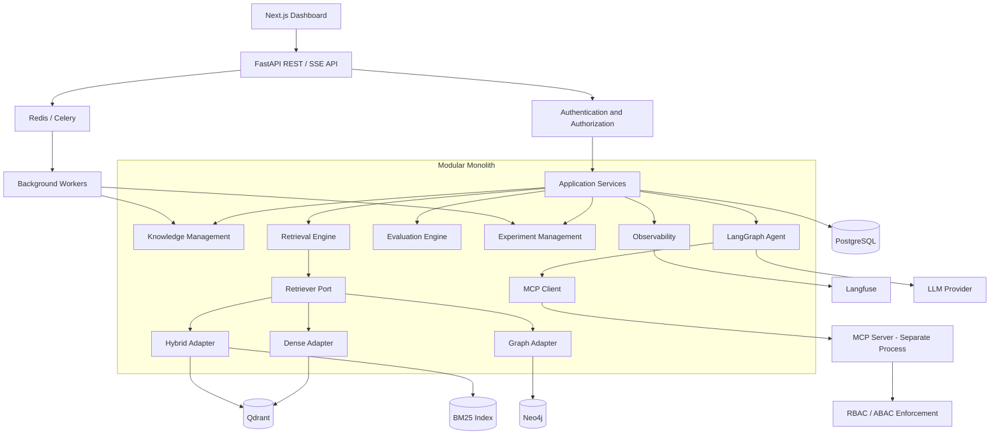
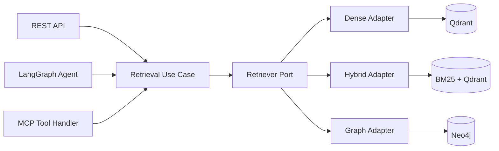
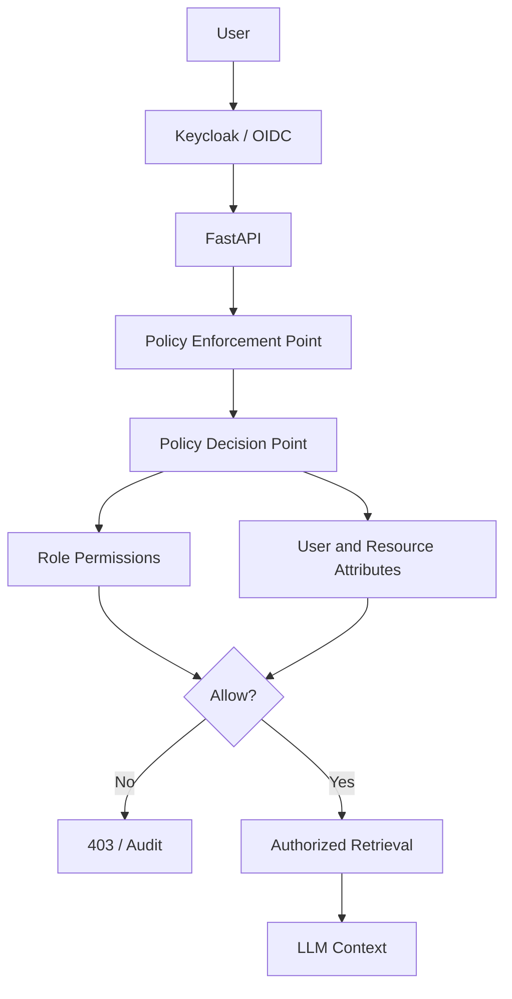
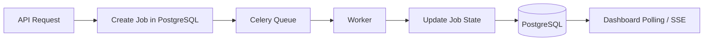
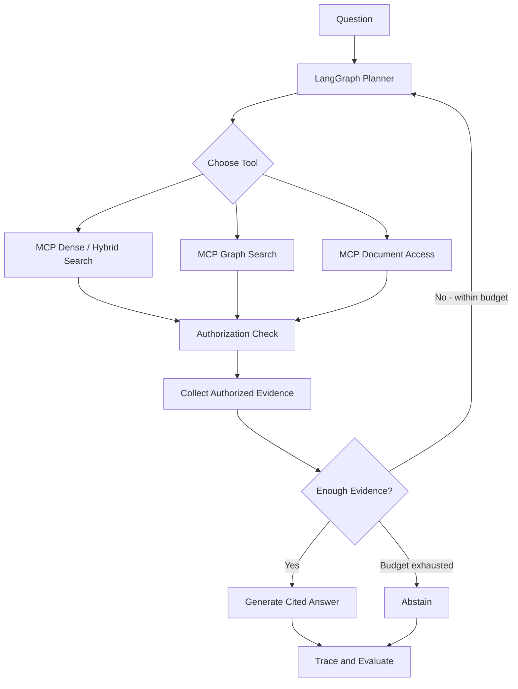

# Enterprise Knowledge EvalOps — Architecture & Flows

## Recommended architecture

**Modular Monolith + Hexagonal Architecture (Ports & Adapters) + Event-Driven Background Workers**, with a separate MCP server, LangGraph agent, and centralized RBAC/ABAC authorization.

## 1. High-level system architecture

## 2. Hexagonal retrieval flow

## 3. RBAC + ABAC authorization flow

Authorization must be enforced at API, MCP tool, search/index, graph traversal, document access, and trace visibility boundaries. Never trust identity attributes supplied by an LLM.

## 4. Background job flow

## 5. MCP agent flow

## 6. Deployment units

| Unit | Purpose |
|---|---|
| Next.js | Dashboard |
| FastAPI | Modular monolith API |
| Celery worker | Ingestion and evaluation jobs |
| MCP server | Authenticated retrieval tools |
| PostgreSQL | Transactional data and evaluation results |
| Qdrant | Dense vector index |
| BM25 index | Sparse search |
| Neo4j | Knowledge graph |
| Redis | Broker and optional cache |
| Keycloak / OIDC | Authentication |
| Cerbos or OPA | Authorization policy decisions |
| Langfuse / OpenTelemetry | Tracing and observability |

## 7. Module boundaries

- Identity & Access: tenant membership, RBAC, ABAC, policies, audit.
- Knowledge: documents, ingestion, chunking, indexing, versioning.
- Retrieval: Dense, Hybrid, GraphRAG through shared ports.
- Agents & MCP: LangGraph orchestration and secured MCP tool integration.
- Evaluation: datasets, retrieval and answer metrics, tool-use scoring.
- Experiments: configurations, jobs, runs, comparison, regression tests.
- Observability: traces, tokens, cost, latency, errors.

## 8. Implementation order

1. Identity, tenant isolation, RBAC/ABAC.
2. Document ingestion and Dense/Hybrid retrieval.
3. Evaluation datasets, experiment runner, and metrics.
4. GraphRAG and permission-aware graph traversal.
5. MCP server and LangGraph agent.
6. Tracing, dashboard, regression tests, Docker deployment.

## 9. Architecture decisions

- ADR-001: Modular monolith over microservices.
- ADR-002: Hexagonal retrieval adapters.
- ADR-003: Centralized RBAC + ABAC policy engine.
- ADR-004: MCP for tool interoperability.
- ADR-005: Celery for asynchronous workloads.
- ADR-006: PostgreSQL as source of truth.
- ADR-007: Qdrant and Neo4j as specialized indexes.
- ADR-008: Langfuse + OpenTelemetry for observability.
